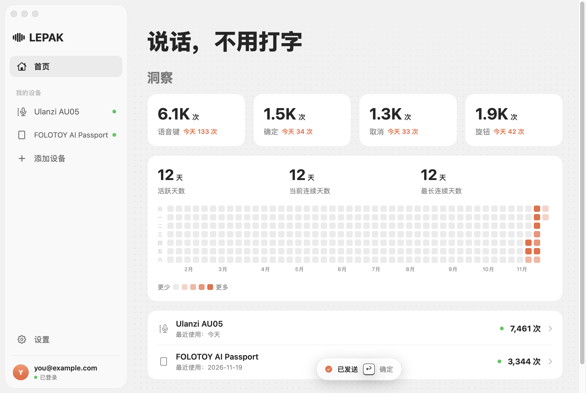
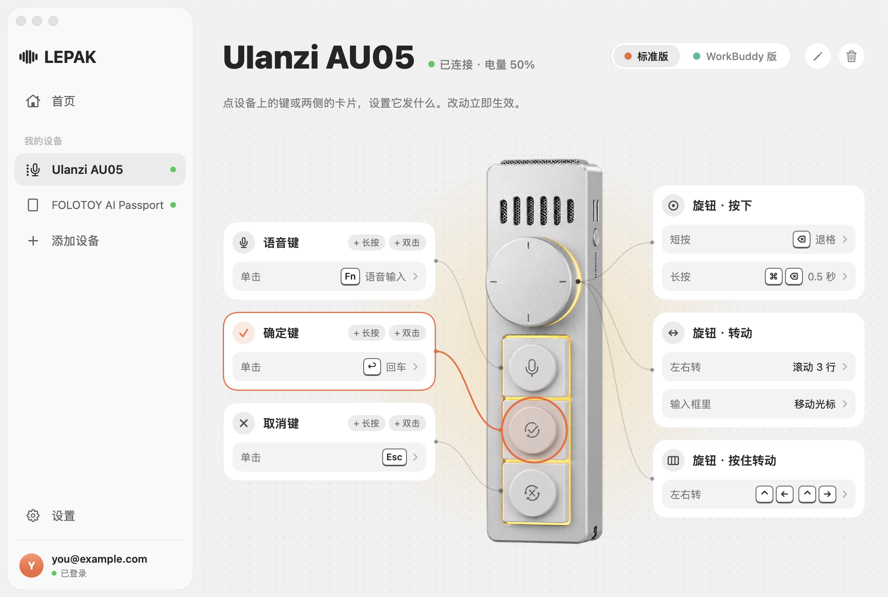
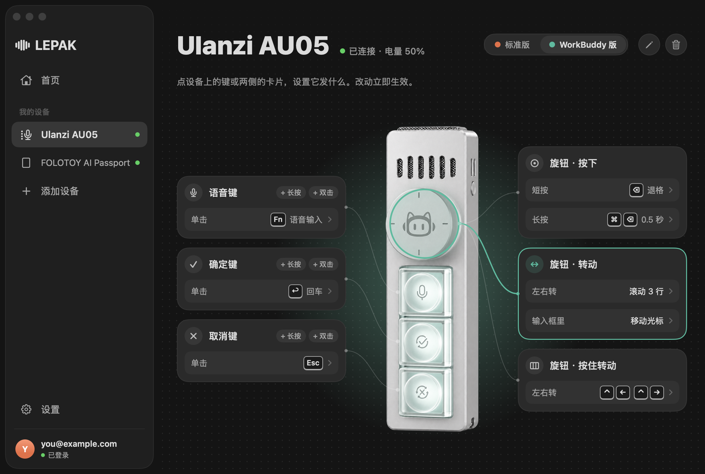
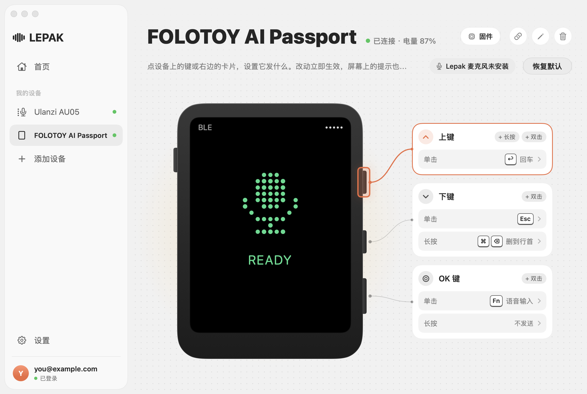

# Lepak

A native macOS menu bar companion app for voice-first hardware controllers — built for **Ulanzi AU05 (Vibe Key)** and **FOLOTOY AI Passport**.

Lepak turns hardware voice buttons, confirm/cancel keys, and rotary knobs into seamless macOS dictation triggers (`Fn` for macOS Dictation / Typeless, etc.) and customizable shortcuts — **with zero system-wide keylogging**.



## Supported Devices

### 1. Ulanzi AU05 (Vibe Key)

A USB / wireless desktop voice keypad & microphone with a rotary knob and three dedicated keys (Voice, Confirm, Cancel).

- **HID Config Interface (`0xFFFC`)**: Reads button and knob events directly from the device's vendor HID interface (with a 1-second heartbeat so the device stays in companion mode).
- **Flexible Key Mapping**: Customize single-press, long-press, and double-tap actions for Voice, Confirm, and Cancel keys, plus short/long press for the knob.
- **Smart Rotary Knob**: Scroll pages normally, move the text cursor automatically when focused in an input field, or hold-and-turn to switch macOS Spaces.
- **Themes**: Supports both the **Standard** and **WorkBuddy** hardware editions in Light and Dark mode.

| Standard Edition (Light) | WorkBuddy Edition (Dark) |
| --- | --- |
|  |  |

### 2. FOLOTOY AI Passport

A pocket-sized ESP32-C3 screen device with three side buttons (Up, Down, OK) and a built-in microphone.

- **BLE Companion Link**: Connects over Bluetooth Low Energy with pairing protection to receive Up, Down, and OK key events with customizable single-press, long-press, and double-tap mappings.
- **One-Click USB Firmware Flashing**: Includes Lepak's open-source ESP32-C3 firmware (`Firmware/Passport`) and bundled `esptool`, allowing one-click installation and updates directly from Settings.
- **Virtual Microphone (`LepakMic.driver`)**: Optional CoreAudio HAL driver that streams audio from AI Passport so any macOS app can use it as a standard microphone.



## Privacy by Design

- **No Keylogging**: Release builds contain zero global keyboard hooks (`CGEventTap`, `NSEvent` monitors, or HID keyboard listeners) and never request **Input Monitoring** permission.
- **Minimal Permissions**: Only **Accessibility** (to synthesize keys/scroll via `CGEvent.post`) and **Bluetooth** (when using AI Passport over BLE) are requested.
- **Local-Only Insights**: Daily button press counts are stored locally at `~/Library/Application Support/Lepak/usage.json` — no text, no computer keyboard input, and no telemetry.

## Installation

### Download Prebuilt Release

Requires **Apple Silicon Mac (arm64)** running **macOS 14 or later**.

1. Download the latest `Lepak-v*-macos-arm64.zip` from [GitHub Releases](../../releases).
2. Unzip and drag `Lepak.app` into `/Applications`.
3. Because prebuilt releases are ad-hoc signed, clear the quarantine attribute before opening for the first time:
   ```bash
   xattr -cr /Applications/Lepak.app
   ```
4. Launch **Lepak** and grant **Accessibility** permission (plus **Bluetooth** if using AI Passport).

### Build from Source

Requires Xcode / Swift 6 toolchain on macOS 14+.

```bash
# Development build
./scripts/package-app.sh

# Optimized release build
LEPAK_BUILD_CONFIG=release ./scripts/package-app.sh
```

The packaged app bundle will be written to `dist/Lepak.app`.

## Project Structure

- `Sources/LepakKit/` — Core HID (`AU05`), BLE (`AI Passport`), virtual mic bridge, and firmware flashing logic.
- `Sources/menubar/` — SwiftUI / AppKit macOS menu bar app and Settings UI.
- `Driver/LepakMic/` — Universal (`arm64` + `x86_64`) CoreAudio HAL virtual microphone driver.
- `Firmware/Passport/` — Open-source ESP32-C3 firmware for FOLOTOY AI Passport (based on [InputBetter](https://github.com/racall/InputBetter)).
- `scripts/` — Build, packaging, and firmware release scripts.

## License

This project is licensed under the [MIT License](LICENSE).

Third-party components and notices:
- `Firmware/Passport/` — MIT License (see [Firmware/Passport/LICENSE](Firmware/Passport/LICENSE) and [Firmware/Passport/THIRD_PARTY_NOTICES.md](Firmware/Passport/THIRD_PARTY_NOTICES.md)).
- Bundled `esptool` binary (downloaded during packaging) — GPL-2.0 License, included alongside the app bundle as a standalone helper.
