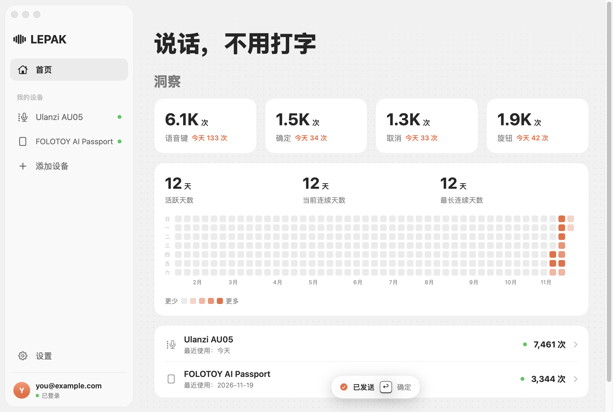
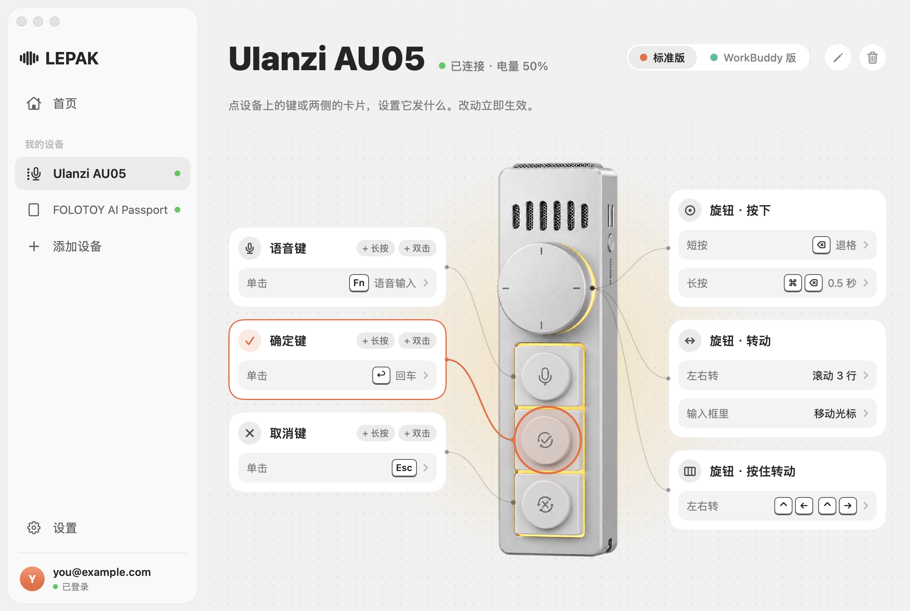
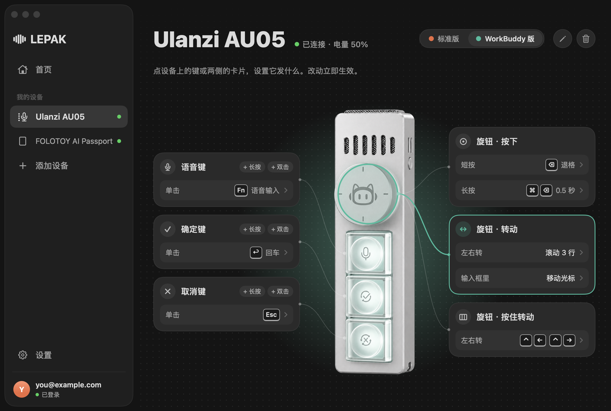
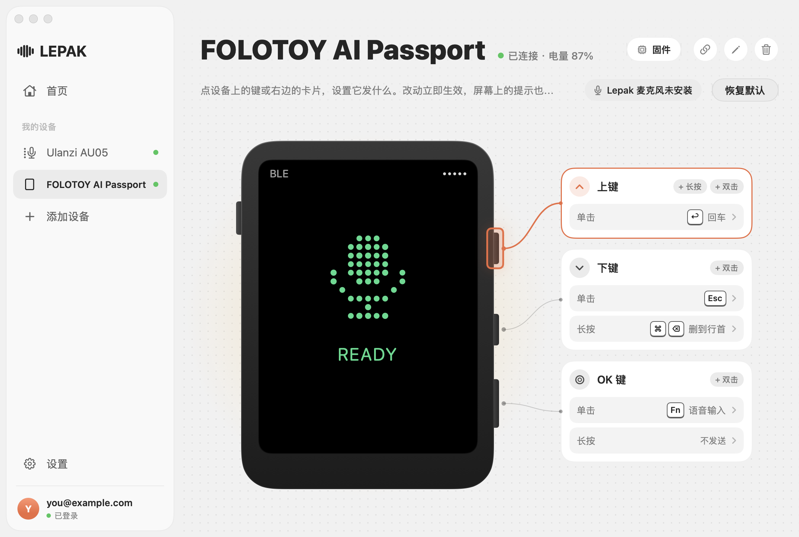

# Lepak

[English](README.md) | **简体中文**

专为语音优先硬件控制器打造的原生 macOS 菜单栏伴侣程序，目前支持 **Ulanzi AU05（Vibe Key）** 和 **FOLOTOY AI Passport** 两款设备。

Lepak 将硬件上的语音键、确定 / 取消键与旋钮转化为顺手的 macOS 语音输入触发器（例如把语音键映射为 `Fn` 交给 macOS 听写或 Typeless 等语音输入法）和自定义快捷键——**且正式版不包含任何系统级键盘监听**。



## 支持的设备

### 1. Ulanzi AU05（Vibe Key）

带旋钮和三颗独立按键（语音、确定、取消）的桌面语音键盘麦。

- **原生 HID 配置口（`0xFFFC`）**：直接读取设备配置口上报的按键与旋钮事件，并保持每秒 1 次心跳，避免设备回退到独立模式。
- **灵活的按键映射**：语音键、确定键、取消键均支持自定义单击、长按、双击动作，旋钮支持短按与长按自定义。
- **智能旋钮**：日常滚动页面；当焦点和鼠标停在可编辑输入框时自动切换为左右移动光标；按住旋钮转动可切换 macOS 桌面空间（Spaces）。
- **外观主题**：支持 **标准版** 与 **WorkBuddy 版** 两款外观，完整适配浅色与深色模式。

| 标准版（浅色） | WorkBuddy 版（深色） |
| --- | --- |
|  |  |

### 2. FOLOTOY AI Passport

随身便携的 ESP32-C3 屏幕语音设备，配备三颗侧键（上、下、OK）与内置麦克风。

- **低功耗蓝牙（BLE）连接**：带配对保护的 BLE 协议，接收上、下、OK 三键事件，支持自定义单击、长按、双击映射，并在设备屏幕上实时同步按键提示。
- **USB 一键安装与更新固件**：内置开源 ESP32-C3 固件（`Firmware/Passport`）与乐鑫官方 `esptool`，可在设置页一键刷写和升级，首次刷写前自动备份整片 Flash 并保护出厂 `cardid` 分区。
- **虚拟麦克风（`LepakMic.driver`）**：可选安装的 CoreAudio HAL 虚拟麦克风驱动，将 AI Passport 的麦克风音频实时桥接到 macOS，供任意语音应用使用。



## 隐私原则

- **零键盘监听**：正式版二进制不包含任何全局键盘钩子（`CGEventTap`、`NSEvent` 全局监听或 HID 键盘接口监听），从不申请「输入监控」权限，CI 每次发版都会自动校验二进制符号。
- **最小权限**：仅申请「辅助功能」（用于通过 `CGEvent.post` 代发按键和滚轮事件）以及「蓝牙」（连接 AI Passport 时需要）。
- **纯本地洞察**：首页「洞察」仅在本地 `~/Library/Application Support/Lepak/usage.json` 统计每天的设备按键次数，不记录文字内容、不记录电脑键盘、不上传任何数据。

## 安装与使用

### 下载预构建版本

系统要求：**Apple Silicon Mac（arm64）**，**macOS 14 及以上**。

1. 前往 [GitHub Releases](../../releases) 下载最新的 `Lepak-v*-macos-arm64.zip`。
2. 解压后将 `Lepak.app` 拖入 `/Applications`（应用程序）文件夹。
3. 由于预构建包使用临时签名，首次打开前请在终端执行以下命令清除隔离属性：
   ```bash
   xattr -cr /Applications/Lepak.app
   ```
4. 打开 **Lepak**，按引导授予「辅助功能」权限（若使用 AI Passport，同时授予「蓝牙」权限）。

### 从源码构建

需要 macOS 14+ 与 Xcode / Swift 6 工具链：

```bash
# 开发构建
./scripts/package-app.sh

# Release 优化构建
LEPAK_BUILD_CONFIG=release ./scripts/package-app.sh
```

打包产物位于 `dist/Lepak.app`。

## 项目结构

- `Sources/LepakKit/` — 核心逻辑：AU05 HID 通信、AI Passport BLE 协议、虚拟麦克风桥接与 USB 固件刷写。
- `Sources/menubar/` — SwiftUI / AppKit 原生 macOS 菜单栏程序与设置界面。
- `Driver/LepakMic/` — Universal（`arm64` + `x86_64`）CoreAudio HAL 虚拟麦克风驱动。
- `Firmware/Passport/` — FOLOTOY AI Passport 开源 ESP32-C3 固件（基于 [InputBetter](https://github.com/racall/InputBetter)）。
- `scripts/` — 构建、打包与固件发布脚本。

## 开源协议

本项目基于 [MIT License](LICENSE) 开源。

第三方组件与声明：
- `Firmware/Passport/` — MIT 协议（详见 [Firmware/Passport/LICENSE](Firmware/Passport/LICENSE) 与 [Firmware/Passport/THIRD_PARTY_NOTICES.md](Firmware/Passport/THIRD_PARTY_NOTICES.md)）。
- 打包时随 App 附带的独立辅助程序 `esptool` — GPL-2.0 协议，许可证文件随 App 打包分发。
